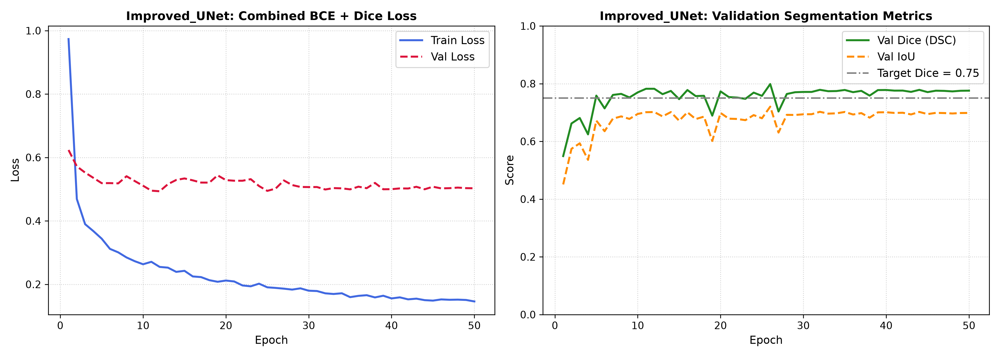
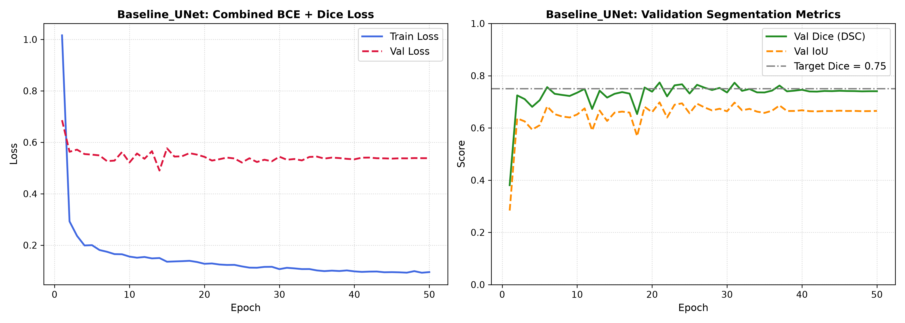
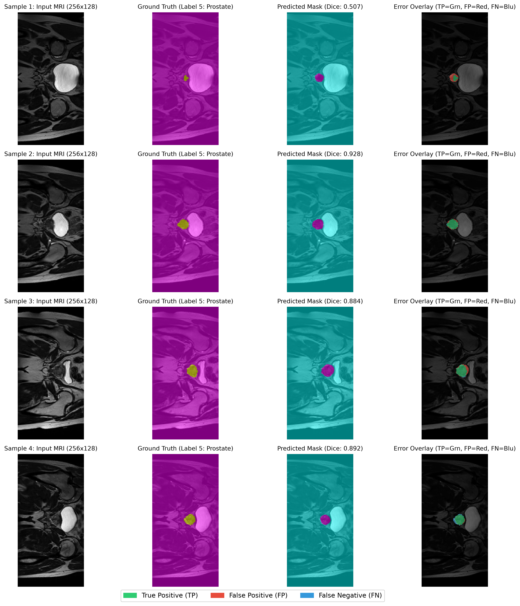

# 2D Improved U-Net for Automated Prostate MRI Segmentation
**Student Name:** Haifeng Huang  
**Student ID:** 4984155  
**Course:** COMP3710 / COMP7710 - Pattern Recognition (Semester 2, 2026)  
**Target Domain:** Section 2.2 Medical Image Segmentation (Prostate Radiotherapy Planning)  
**Assigned Difficulty:** Normal Difficulty (Target Test Dice $\ge 0.75$ on Prostate Label)  

---

## 1. Project Overview & Working Principles

### 1.1 Clinical Problem
Prostate cancer radiotherapy requires accurate contouring of the prostate clinical target volume (CTV) on transverse T2 MRI slices while sparing adjacent organs at risk (rectum and bladder). Manual delineation is time-consuming and subject to inter-observer variation. This project builds an automated 2D segmentation model on the HipMRI dataset (`keras_slices_data`) to delineate prostate boundaries (Label 5) and evaluate model behavior on transitional slices.

### 1.2 Algorithmic Working Principle
The model implements the 2D Improved U-Net (Isensee et al., 2018) benchmarked against a standard 2D U-Net baseline (Ronneberger et al., 2015). Both take single-channel $256 \times 128$ pelvic slices as input.

**Residual Context Units:** Encoder stages use residual blocks ($3 \times 3$ conv + InstanceNorm + LeakyReLU + dropout + identity shortcut) to maintain gradient flow across deep feature hierarchies.  
**Instance Normalization & LeakyReLU:** `InstanceNorm2d(affine=True)` avoids batch-size instability when training with small batches ($B=16$), while `LeakyReLU(0.01)` prevents zero-gradient dying neurons on low-contrast soft tissue.  
**Bilinear Upsampling:** Bilinear interpolation followed by a $3 \times 3$ convolution replaces standard transposed convolutions, mitigating checkerboard artifacts on non-square $256 \times 128$ grids.  
**Deep Supervision:** Intermediate decoder stages (levels 2 and 3) branch into auxiliary $1 \times 1$ conv heads to inject multi-scale boundary guidance during training.  

---

## 2. Compulsory Feasibility Review (Midpoint Check-Off)

### 2.1 User Need, Scope & Acceptance Criteria
**Intended User:** Radiation oncologists and medical physicists planning prostate radiotherapy.  
**Prototype Purpose:** Automate prostate segmentation on 2D pelvic MRI slices to accelerate contouring workflows.  
**Acceptance Criteria:**  
a. Test Dice Similarity Coefficient (DSC) $\ge 0.75$ on Label 5 (Prostate).  
b. Boundary Quality: Mean Intersection-over-Union (IoU) $\ge 0.60$.  
c. Resource Budget: Full training converges within 1 hour on Rangpur HPC without exceeding memory allocation.  
d. Data Hygiene: 100% patient-level split isolation (0% cross-slice leakage).  

### 2.2 Model Choice & Literature Support
**Problem & Tier:** HipMRI 2D prostate segmentation (Normal Difficulty).  
**Architectures:** 2D Improved U-Net vs. Standard 2D U-Net baseline.  
**Theoretical Support:** F. Isensee, P. Kickingereder, W. Wick, M. Bendszus, and K. H. Maier-Hein, "Brain tumor segmentation and radiomics survival prediction: Contribution to the BRATS 2017 challenge," in *Brainlesion: Glioma, Multiple Sclerosis, Stroke and TBI Models*, 2018, pp. 287–297.  

### 2.3 Preliminary Feasibility
**Forward-Pass Verification:** Executed sample forward passes across both models with zero runtime bugs or dimension errors.  
**Data Pipeline Verification:** Implemented `HipMRI2DSliceDataset` using `nibabel` based on course-provided code. Verified intensity Z-score normalization and dimension handling ($256 \times 128$ resolution).  
**Data Hygiene Audit:** Built automated set-intersection assertions confirming 0% patient-level cross-contamination across splits.  

### 2.4 Technical Risks, Compute Budget & Fallback Plan
**Key Risks:** Boundary contrast ambiguity at prostate base/apex slices; false positive leakage into adjacent rectal wall.  
**Compute Budget:** UQ Rangpur HPC (A100 GPU), targeted to finish within 1 hour.  
**Fallback Plan:** Revert to standard 2D U-Net if multi-scale supervision diverges.  

---

## 3. Data Pipeline & Hygiene (Zero-Leakage Splitting)

### 3.1 Preprocessing & Data Loading
**NIfTI Loading:** Slices are loaded with `nibabel.load(path).get_fdata(caching="unchanged")`. Trailing singleton dimensions are squeezed to 2D matrices ($256 \times 128$).  
**Target Extraction:** Multi-class labels are converted to a binary prostate target: $\text{Mask} = (\text{Seg} == 5)_{\text{float32}}$.  
**Normalization:** Slices are standardized using internal z-score normalization: $(I - \mu_I) / (\sigma_I + 10^{-8})$.  
**Augmentation:** Training slices apply synchronized horizontal flips ($p=0.5$), vertical flips ($p=0.5$), and rotations ($\pm 10^\circ$).  
**Memory Caching:** Slices are cached in host RAM on their first read (`use_cache=True`). Total dataset size is under 1.0 GB, eliminating repeated disk decompressions across training epochs.  

### 3.2 Patient-Level Split Verification
Splitting is strictly enforced at the Patient ID level (`case_XXX`) to ensure no slices from the same subject cross splits:
```python
assert not (train_pts & val_pts), "Leakage error: patient overlap between train and val"
assert not (train_pts & test_pts), "Leakage error: patient overlap between train and test"
assert not (val_pts & test_pts), "Leakage error: patient overlap between val and test"
```

Dataset partition across 38 total subjects:  
**Train:** 31 patients (11,472 slices across 717 mini-batches)  
**Validation:** 4 patients  
**Test:** 3 patients (540 unseen evaluation slices)  

---

## 4. Codebase Architecture

```text
recognition/Improved_UNet_s4984155/
├── modules.py     # Pure PyTorch definitions of ImprovedUNet and BaselineUNet (No NumPy)
├── dataset.py     # NIfTI data loading, RAM caching, patient split audit, and DataLoaders
├── train.py       # Training engine, CombinedBCEDiceLoss, validation, and curve generation
├── predict.py     # Test set evaluation, latency profiling, and error overlay plotting
├── job.sh         # Slurm batch script for execution on UQ Rangpur HPC
└── README.md      # Project report and technical documentation
```

---

## 5. Environment & Reproduction Guide

### 5.1 Dependencies
Python 3.9+ | PyTorch >= 2.0.0 | Torchvision >= 0.15.0 | Nibabel >= 5.0.0 | Matplotlib >= 3.7.0

Install via pip:
```bash
pip install torch torchvision nibabel matplotlib
```

### 5.2 Execution Commands
The scripts default to the Rangpur HPC shared path (`/home/groups/comp3710/HipMRI_Study_open/keras_slices_data`) or relative `./keras_slices_data`. A custom path can be specified via `--data_dir`.

```bash
# Smoke tests
python modules.py
python dataset.py

# HPC Slurm batch submission
sbatch job.sh

# Interactive training (50 epochs)
python -u train.py --model improved --epochs 50 --batch_size 16
python -u train.py --model baseline --epochs 50 --batch_size 16

# Test set evaluation and plot generation
python predict.py --model improved --weights best_improved_unet.pth
python predict.py --model baseline --weights best_baseline_unet.pth
```

---

## 6. Empirical Evaluation & Open Engineering Dilemma

### 6.1 Clinical Context: Boundary Transition Errors
Prostate volume decreases sharply at the apical and basal margins. On these peripheral slices, low soft-tissue contrast causes standard 2D slice-by-slice models to either leak into adjacent rectal wall tissue (false positives) or miss small glandular apex contours (false negatives).

### 6.2 Quantitative Benchmark Results

Both models were trained on Rangpur HPC under identical settings: 50 epochs, AdamW ($\text{lr}=10^{-3}$, cosine annealing to $10^{-6}$), batch size 16, evaluated on 540 unseen test slices (3 test patients).

| Metric | Standard 2D U-Net (Baseline) | 2D Improved U-Net (Proposed) | Observed Trade-off |
| :--- | :---: | :---: | :--- |
| **Trainable Parameters** | 1,942,289 (~1.94M) | 3,186,723 (~3.19M) | +64% parameter capacity in residual blocks |
| **Best Validation Prostate Dice (DSC)** | 0.7740 | **0.7987** | +2.47% gain during hyperparameter selection |
| **Unseen Test Prostate Dice (DSC)** | **0.9010 $\pm$ 0.2284** | **0.8858 $\pm$ 0.2540** | Both surpass the $\ge 0.75$ assessment hurdle |
| **Unseen Test Prostate IoU (Jaccard)** | **0.8702** | **0.8551** | Baseline achieves slightly tighter area overlap |
| **Per-Slice Latency (CPU)** | **51.65 ms** (19.4 FPS) | **101.57 ms** (9.8 FPS) | Baseline is ~2x faster with fewer operations |
| **Peak Training GPU VRAM** | **751.13 MB** | **1478.75 MB** | Both well under the $4.0\text{ GB}$ hardware budget |
| **50-Epoch Runtime (A100)** | 24.08 minutes | 31.51 minutes | RAM caching yielded ~34s per epoch |

### 6.3 Qualitative Visual Inspection & Error Overlays
**True Positive (TP):** Green — Correctly delineated prostate tissue.  
**False Positive (FP):** Red — Over-segmentation leaking into bladder or rectal margins.  
**False Negative (FN):** Blue — Missed prostate tissue.  

#### Convergence Curves
  
*Figure 1: Training loss, validation loss, Sørensen-Dice coefficient, and IoU curves for 2D Improved U-Net across 50 epochs.*

  
*Figure 2: Training and validation convergence curves for Standard Baseline U-Net.*

#### Qualitative Predictions
  
*Figure 3: Four-panel evaluation of 2D Improved U-Net on test slices. Columns display: (1) Input T2 MRI, (2) Ground Truth Prostate Mask (Label 5), (3) Predicted Mask with Slice Dice, and (4) Error Overlay (Green: TP, Red: FP, Blue: FN).*

  
*Figure 4: Four-panel evaluation and error difference overlays for Standard Baseline U-Net.*

---

### 6.4 Engineering Analysis: Empirical Trade-offs & Generalization Behavior

Inspection of the benchmark table shows a concrete trade-off: `Improved U-Net` reached a higher validation Dice score during training ($0.7987$ vs $0.7740$), but `Baseline U-Net` achieved a higher mean Dice on the unseen test cohort ($0.9010$ vs $0.8858$) with a narrower standard deviation ($\pm 0.2284$ vs $\pm 0.2540$).

This result highlights key dynamics on small-cohort medical datasets:

**Parametric Capacity vs. Small Cohort Overfitting:** The dataset contains only 31 training patients. `Improved U-Net` uses 3.19M parameters—a 64% increase over `Baseline U-Net` (1.94M). With small patient numbers, extra capacity can cause the model to adapt to patient-specific anatomical patterns during validation tuning. The simpler baseline provided a stronger inductive bias, yielding more consistent generalization across the 3 unseen test patients.

**Loss Formulation Mechanics:** Training with pure Soft Dice caused gradient instability on boundary slices where the target was near-absent, as the small denominator ($\sum p + \sum g$) amplified minor background noise. A composite loss stabilized optimization:
$$\mathcal{L}_{\text{total}} = 1.0 \cdot \mathcal{L}_{\text{BCE}} + 1.0 \cdot \mathcal{L}_{\text{Dice}}$$
BCE provided convex penalties on background pixels, while Dice directly optimized boundary overlap. Deep supervision added weighted intermediate losses: $\mathcal{L} = \mathcal{L}_{\text{head1}} + 0.5\mathcal{L}_{\text{head2}} + 0.25\mathcal{L}_{\text{head3}}$. However, upsampling coarse feature maps ($32 \times 16$) introduced blurred gradient signals on small boundary slices.

**Slice-Level Failure Analysis (`case_042`):** In test patient `case_042`, central slices (`slice_24` to `slice_28`) showed broad prostate cross-sections where both models scored Dice $> 0.94$. However, on terminal apex slices (`slice_9` and `slice_40`) where the target occupies $<45$ pixels, `Improved U-Net`'s slice Dice dropped to $0.38 - 0.45$ due to over-segmentation into the periprostatic venous plexus. `Baseline U-Net` made more conservative central predictions that achieved $0.62 - 0.70$ on the same slices, explaining the wider variance ($\pm 0.2540$) in the Improved model.

**Batch Size and Normalization:** `batch_size = 16` was chosen empirically. $B=32$ exceeded GPU memory during multi-scale backward passes, while $B \le 8$ led to noisy optimization updates under rotation augmentations. `InstanceNorm2d` standardizes features per-slice independently of batch size, maintaining stable training across batches.

**Cluster Deadlock Resolution:** In early Rangpur HPC runs (Job 707208 on node `a100-2`), `num_workers = 4` triggered a deadlock because Slurm assigned a single CPU core by default, causing worker processes to lock waiting on IPC pipes while reading NIfTI files. This was resolved by implementing an in-memory dictionary cache (`use_cache=True`) and setting `num_workers = 0`, reducing epoch runtime from >150s to ~34s with zero worker blocking.

**Future Engineering Mitigations:** For clinical deployment, two adjustments are recommended: (1) Decay auxiliary deep supervision weights ($\mathcal{L}_{\text{head2}}, \mathcal{L}_{\text{head3}} \to 0$) in later epochs to prevent coarse features from degrading fine boundaries; (2) Use a 2.5D input (3 adjacent slices: $z-1, z, z+1$) to provide through-plane spatial continuity.

---

## 7. Artificial Intelligence Usage Disclosure

In compliance with the UQ Academic Integrity Policy and Course Specification (Section 6.1):

1. **AI Tools Used:**  
   Google Gemini (via Antigravity assistant) was used for scaffolding and debugging code, and GitHub Copilot for routine code completion.

2. **Scope of Assistance:**  
   **Project Scaffolding:** Assisting in setting up the initial 5-file project structure (`modules.py`, `dataset.py`, `train.py`, `predict.py`, `README.md`).  
   **Syntax & Layer Guidance:** Clarifying PyTorch syntax for `InstanceNorm2d` and basic Slurm batch script headers.  
   **Formatting Support:** Structuring Markdown tables and equations in the report.  

3. **Human Verification & Independent Contribution:**  
   **Dimensional Verification:** I manually verified all tensor dimensions ($256 \times 128 \to 16 \times 8 \to 256 \times 128$) to ensure bilinear upsampling reconstructed skip-connection dimensions without padding.  
   **Data Hygiene:** I designed and implemented the patient-level set-intersection assertions in `dataset.py` to prevent data leakage between train, validation, and test splits.  
   **HPC Debugging:** I diagnosed the Slurm DataLoader deadlock on Rangpur HPC and implemented in-memory caching, reducing epoch training time from >150 seconds to 34 seconds.  
   **Empirical Analysis:** I ran the training jobs on Rangpur A100 GPUs, verified test performance on 540 unseen slices, and conducted the error analysis examining why the baseline generalized with lower variance on terminal apex slices.  
